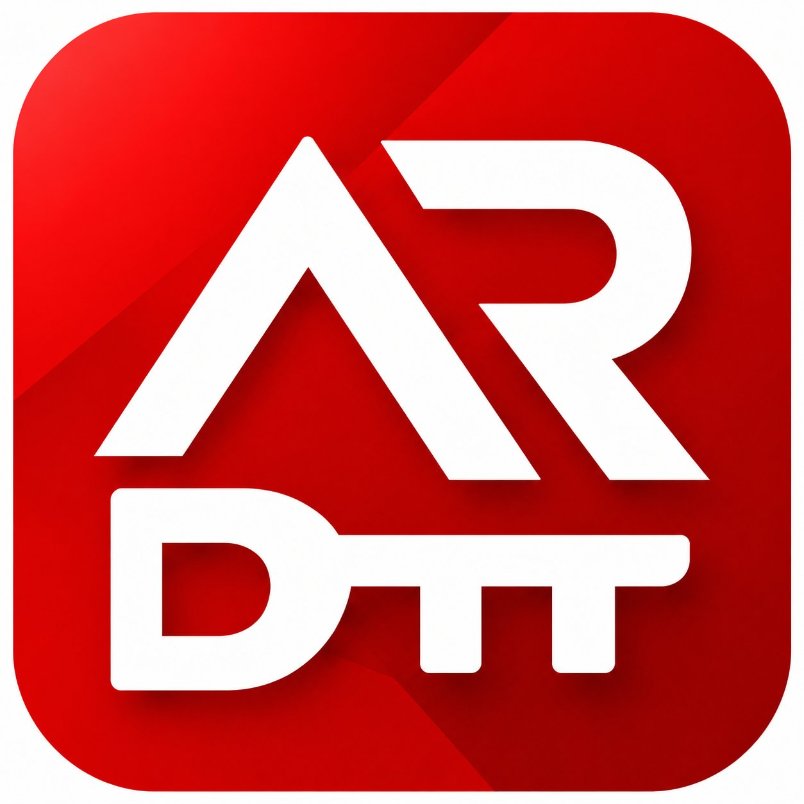

<div align="center">



# ARDTT

[](https://github.com/2kristalls36-hue/ARDTT/releases/latest)
[](LICENSE)

[Скачать APK](https://github.com/2kristalls36-hue/ARDTT/releases/latest)
·
[Документация](docs/README.md)
·
[Поддержка автора](https://spasibomir.ru/pay/34807)

</div>

> [!CAUTION]
> **Ранняя бета.** Текущая версия нестабильна. Автор **не несёт ответственности** за работу деплой-части (установка и обновление стека на VPS из приложения или с Git). Установка клиента и сервера — **на свой страх и риск**.

**ARDTT** (Amnezia & Raw Dial over TURN Tunnel) — открытый Android-клиент и self-hosted стек **в этом репозитории**: туннель до **вашего** VPS. Прямой путь — AmneziaWG 2.0 по UDP. Обход поднимает локальный интерфейс на устройстве и несёт сырые IP-пакеты через TURN, маскируя транспорт под зашифрованный медиатрафик звонка (RAW Dial via TURN: WRAP).

Клиент — `android/`, сервер — `server/`. Репозиторий **публичный**. Стек **не** вшит в APK: телефон по SSH передаёт установщик `ardtt-deploy.sh`, а **VPS** сам скачивает из GitHub Releases один файл образа `ardtt-server-<DEPLOY_VERSION>-linux-<amd64|arm64>.image.tar.gz`, проверяет SHA-256 и делает `docker load`, без build/pull/git.

> [!WARNING]
> **Назначение проекта**
> ARDTT — технический инструмент для туннелирования трафика через **ваш** сервер (VPS). Проект распространяется в ознакомительных и исследовательских целях, в том числе для изучения сетевых протоколов и self-hosted VPN.
>
> Автор **не призывает** использовать ARDTT для обхода блокировок или нарушения правил платформ и **не несёт ответственности** за сценарии применения пользователями. Это неофициальный продукт: не Amnezia, не VK и не Cloudflare.

> [!NOTE]
> Клиент **0.5.271** (`versionCode` считается CI из истории git, ≈ число коммитов × 10), пакет `com.ardtt.app`. Серверный стек **1.0.57** (`DEPLOY_VERSION`, каталог `/opt/ardtt`). Канонический источник стека — актив Releases, не `assets/` APK. Старые APK (ждут `ardtt-stack-*.tar.gz` / `main`) этот пакет не ставят.
>
> Заметки релиза — [CHANGELOG.md](CHANGELOG.md). Документы — [docs/](docs/README.md).

---

## Сейчас

| | |
|---|---|
| Клиент | **0.5.271** · minSdk 28 · APK `arm64-v8a` / `armeabi-v7a` / `x86_64` / universal · [Releases](https://github.com/2kristalls36-hue/ARDTT/releases/latest) |
| Стек | **1.0.57** · `/opt/ardtt` · один контейнер, isolated netns, labels `com.ardtt.owner` · переменные `ARDTT_*` + JSONL protocol=2 |
| Откуда стек | GitHub Releases: `ardtt-server-1.0.57-linux-<amd64\|arm64>.tar.gz` (docker save + Engine), рядом `…index.json` и ассеты по слоям — **частичный деплой: VPS качает только недостающее**. Не APK, не исходники |
| Контейнер | один `docker run`: provision/direct/bypass/dns/warp/cascade/telemetry; host-порты на 51820/56003/9100/9200 внутри |
| Профиль | ссылка `ardtt://config` |
| Обновления | публичные GitHub Releases [`2kristalls36-hue/ARDTT`](https://github.com/2kristalls36-hue/ARDTT/releases): APK, `ardtt-update.json`, пакеты сервера — без PAT. Только стабильные `versionName` (без `test`). Тестовые APK — [Actions → Artifacts](https://github.com/2kristalls36-hue/ARDTT/actions) |

## Два пути до VPS

| | Прямое | Обход |
|---|---|---|
| Стек | AmneziaWG 2.0 | RAW Dial via TURN (qWDTT / SpaceNeuroX, `-listen-raw`) |
| Транспорт | UDP `:51820` | TURN/TCP → WRAP → VPS UDP `:56003` |
| Подсеть | `10.8.0.0/24` | `10.9.0.0/24` |
| Крипто | AmneziaWG | WRAP AEAD, **без DTLS**, **без вложенного WG** |

**«Скрыть свой IP»** — не третий клиентский путь: egress выбранного пользователя через Cloudflare WARP (`wireproxy` + `tun2socks`). DNS `:53` остаётся на `main`.

**Каскад** (два VPS): телефон знает только **вход**; WAN и Hide-IP WARP — на **выходе**. Hide-IP выкл. → интернет с WAN выхода, не через Cloudflare.

## Репозиторий

Публичный канонический источник **клиента и стека**. Push в `main` собирает подписанный APK. Если в `versionName` есть `test` — файл только в **Actions → Artifacts**. Стабильная версия публикует GitHub Release: APK, `ardtt-update.json` и `ardtt-server-<DEPLOY_VERSION>-linux-*.tar.gz`. В APK остаётся метка `deploy/DEPLOY_VERSION`.

`versionCode` в CI считается автоматически из истории git (`scripts/compute-version-code.sh`: релиз — `git rev-list --count HEAD` × 10, preview — база × 10 плюс число коммитов PR, не больше 9). Поэтому каждая публикация ставится поверх предыдущей. Вручную бампать нужно только `releaseVersionName`; `releaseVersionCode` — нижняя граница для локальных сборок.

```
ARDTT/
├── android/      # Jetpack Compose-клиент (Gradle живёт здесь)
├── server/       # единый Docker-образ ardtt (compose profile isolated)
├── scripts/      # APK, pack-server-package (docker save), проверки установщика
├── docs/         # LEGEND, ARCHITECTURE, DEPLOY, TELEMETRY
├── .github/      # сборка APK (Releases только без test в versionName)
├── CHANGELOG.md
├── LICENSE       # GNU GPL v3
└── NOTICE        # Amnezia Apache-2.0 + SpaceNeuroX/qWDTT GPL RAW
```

Клиент и Gradle **не** вынесены в корень: сборка — `cd android && ./gradlew …`.

## Как поставить

Деплой в ранней бете: автор не обещает, что установка стека отработает, и не несёт за это ответственности. Ставите **на свой страх и риск**.

Стек ставится **из приложения** или **одним скриптом** по SSH. В обоих случаях VPS скачивает с GitHub Releases один файл образа, сверяет SHA-256 и запускает один контейнер. Если новая версия не прошла проверку, возвращается предыдущая. Docker берётся тот, что уже есть, или ставится из репозитория дистрибутива. Подробности: [docs/DEPLOY.md](docs/DEPLOY.md).

## Быстрый старт

Клиент — готовый APK:

```bash
# https://github.com/2kristalls36-hue/ARDTT/releases/latest
```

Сервер:

```bash
curl -fsSLO https://github.com/2kristalls36-hue/ARDTT/releases/latest/download/ardtt-deploy.sh
sudo ARDTT_PUBLIC_HOST=IP_этого_VPS ARDTT_DEPLOY_VERSION=2.0.0 ARDTT_AUTO_PORTS=1 bash ardtt-deploy.sh
```

Разработчикам (образ из дерева): `scripts/build-server-image.sh` + `scripts/pack-server-image.sh`, затем `ARDTT_IMAGE_FILE=…` — см. [docs/DEPLOY.md](docs/DEPLOY.md).

Каноническая раскладка `/opt/ardtt` — [docs/DEPLOY.md](docs/DEPLOY.md).

Сборка APK из исходников:

```bash
cd android
./gradlew assembleDebug
# app/build/outputs/apk/debug/app-debug.apk
```

Подписанные APK — [GitHub Releases](https://github.com/2kristalls36-hue/ARDTT/releases/latest). Подробнее: [android/README.md](android/README.md), [server/README.md](server/README.md).

## Документация

| Документ | Содержание |
|----------|------------|
| [CHANGELOG.md](CHANGELOG.md) | Линейка 0.5.271 / стек 1.0.57 |
| [docs/LEGEND.md](docs/LEGEND.md) | Имя: Amnezia & Raw Dial over TURN Tunnel |
| [docs/ARCHITECTURE.md](docs/ARCHITECTURE.md) | Схемы, probe, каскад, Hide-IP WARP |
| [docs/DEPLOY.md](docs/DEPLOY.md) | Деплой v2: один образ из Releases, один скрипт, один контейнер; миграция с 1.0.x |
| [docs/TELEMETRY.md](docs/TELEMETRY.md) | Режим тестирования |
| [docs/UI.md](docs/UI.md) | Дизайн-система клиента: реестр компонентов и токенов, карта экранов, режимы |
| [docs/UI-AUDIT.md](docs/UI-AUDIT.md) | Аудит интерфейса: находки, исправления, отложенное |
| [android/README.md](android/README.md) | Сборка клиента, keystore, релизы |
| [server/README.md](server/README.md) | Контейнер: provision, direct, bypass, dns, warp, cascade, telemetry |

## Поддержать

Донат добровольный и **не открывает** функций: [Спасибо Мир](https://spasibomir.ru/pay/34807). В приложении карточка **«Поддержка автора»**.

## Откуда код

- Path A — [AmneziaWG](https://github.com/amnezia-vpn/amneziawg-android) (Apache-2.0).
- Path B RAW — [SpaceNeuroX/proxy-turn-vk-android](https://github.com/SpaceNeuroX/proxy-turn-vk-android) (GPL-3.0, `-listen-raw`).

## Лицензия

Этот проект распространяется под лицензией **GNU General Public License v3.0** — [LICENSE](LICENSE), атрибуции — [NOTICE](NOTICE).
