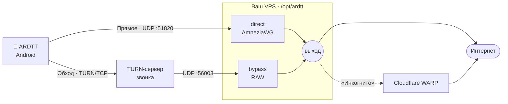

<div align="center">


# ARDTT

**Личный VPN до собственного сервера — с запасным путём на случай, когда прямой закрыт.**

[](https://github.com/2kristalls36-hue/ARDTT/releases/latest)
[](docs/DEPLOY.md)
[](android/README.md)
[](LICENSE)

[**Скачать APK**](https://github.com/2kristalls36-hue/ARDTT/releases/latest) &nbsp;·&nbsp;
[Развернуть сервер](#быстрый-старт) &nbsp;·&nbsp;
[Документация](docs/README.md) &nbsp;·&nbsp;
[Изменения](CHANGELOG.md)

</div>

> [!CAUTION]
> **Ранняя бета.** Текущая версия может работать нестабильно. Автор не несёт ответственности за работу клиента и за установку или обновление серверного стека. Установка выполняется на собственный риск.

## О проекте

**ARDTT** (Amnezia & Raw Dial over TURN Tunnel) — открытый Android-клиент и self-hosted серверный стек для туннеля до **собственного** VPS. Ключи, профили и точка выхода в интернет остаются на сервере владельца.

Проект решает три задачи:

- **Скорость**, когда сеть до сервера доступна: прямой туннель AmneziaWG 2.0 по UDP.
- **Связь**, когда прямой UDP до сервера ограничен: обходной путь передаёт IP-пакеты через TURN, и снаружи трафик похож на медиаданные звонка.
- **Независимость**: весь стек разворачивается на своём сервере, в том числе прямо из приложения.

Клиент сам проверяет сеть и выбирает путь. Режим можно зафиксировать вручную.

## Как это устроено



| | Прямое | Обход |
|---|---|---|
| Технология | AmneziaWG 2.0 | RAW Dial via TURN (линия qWDTT / SpaceNeuroX) |
| Транспорт | UDP `:51820` | TURN/TCP → WRAP → UDP `:56003` |
| Подсеть | `10.8.0.0/24` | `10.9.0.0/24` |
| Шифрование | AmneziaWG | WRAP AEAD, без DTLS и без вложенного WireGuard |
| Когда используется | сеть до сервера доступна | прямой UDP ограничен |

**«Инкогнито»** (настройка «Исходящий адрес») — не третий путь, а способ выхода: трафик пользователя уходит в интернет через Cloudflare WARP, и сайты видят адрес Cloudflare вместо адреса сервера. DNS при этом остаётся на сервере.

**Каскад** — два сервера: телефон подключается только ко входу, выход в интернет происходит со второго сервера.

Подробные схемы — [docs/ARCHITECTURE.md](docs/ARCHITECTURE.md), происхождение имени — [docs/LEGEND.md](docs/LEGEND.md).

## Возможности

<table>
<tr>
<td width="50%" valign="top">

**Подключение**

- Автовыбор пути и переключение между прямым и обходом
- Восстановление при смене Wi‑Fi, мобильной сети и SIM
- Доверенные сети Wi‑Fi: туннель на паузе, при выходе — снова включён
- Режим «Инкогнито»: выход в интернет через Cloudflare WARP

</td>
<td width="50%" valign="top">

**Маршрутизация**

- Исключения для приложений: чёрный или белый список
- Исключения для сайтов и IP-адресов (Android 13+)
- Несколько профилей с быстрым переключением
- Профили по ссылке `ardtt://`, QR-коду, файлу или подписке

</td>
</tr>
<tr>
<td valign="top">

**Удобство**

- Плитки в шторке: включение туннеля и выбор профиля
- Виджет на рабочем столе и ярлыки приложения
- Обновление приложения из GitHub Releases
- Светлая и тёмная тема, иллюстрированный фон

</td>
<td valign="top">

**Администрирование**

- Развёртывание и обновление сервера по SSH из приложения
- Управление пользователями сервера
- Состояние сервера, карта соединения, диагностика и журналы
- Каскад из двух серверов

</td>
</tr>
</table>

Расширенные функции доступны в режиме администратора, который включается в настройках приложения.

## Быстрый старт

### 1. Установите клиент

Скачайте APK из [последнего релиза](https://github.com/2kristalls36-hue/ARDTT/releases/latest). Для большинства телефонов подходит сборка `arm64-v8a`; если архитектура неизвестна — `universal`. Требуется Android 9 или новее.

### 2. Разверните сервер

Подходит чистый Linux `amd64` или `arm64` с `python3`, `systemd` и `/dev/net/tun`. Docker Engine входит в пакет и устанавливается автоматически, если его нет.

| Способ | Как | Кому подходит |
|---|---|---|
| **Из приложения** | Режим администратора → вкладка «Серверы» → «Добавить сервер», доступ по SSH. Сервер сам загружает пакет из GitHub Releases | установка с телефона |
| **Архивом** | Загрузить `ardtt-server-1.0.57-linux-<arch>.tar.gz` из релиза, сверить SHA-256 и запустить `install.sh` из архива | доступ к консоли сервера |

<details>
<summary>Установка архивом — пример</summary>

```bash
# актив ardtt-server-1.0.57-linux-amd64.tar.gz (или arm64) из последнего релиза;
# SHA-256 сверяется с digest или SHA256SUMS релиза
export ARDTT_PUBLIC_HOST=IP_этого_VPS
export ARDTT_PACKAGE=/opt/ardtt/incoming/ardtt-server-1.0.57-linux-amd64.tar.gz
export ARDTT_PACKAGE_SHA256=...
```

Полная последовательность, переменные и коды ошибок — [docs/DEPLOY.md](docs/DEPLOY.md).

</details>

### 3. Подключитесь

На вкладке «Профили» добавьте профиль: по подписке, ссылкой `ardtt://`, из файла, из буфера обмена или сканированием QR-кода. Затем включите туннель на главном экране.

## Версии

| Компонент | Версия | Где |
|---|---|---|
| Клиент | **0.5.271** · пакет `com.ardtt.app` · minSdk 28 | [Releases](https://github.com/2kristalls36-hue/ARDTT/releases/latest) |
| Серверный стек | **1.0.57** · каталог `/opt/ardtt` | актив `ardtt-server-1.0.57-linux-<arch>.tar.gz` |
| Обновления | стабильные версии — GitHub Releases; тестовые сборки — [Actions → Artifacts](https://github.com/2kristalls36-hue/ARDTT/actions) | |

Серверный стек не встроен в APK: сервер загружает пакет из GitHub Releases сам и при обновлении скачивает только изменившиеся слои образа. История изменений — [CHANGELOG.md](CHANGELOG.md).

<details>
<summary>Как устроены сборки и версии</summary>

- Push в `main` собирает подписанный APK. Если в `versionName` есть `test`, сборка остаётся только в Actions → Artifacts; иначе публикуется GitHub Release с APK и `ardtt-update.json`.
- Каждый pull request собирает предварительный APK в артефакты, без релиза.
- `versionCode` вычисляется в CI из истории git (`scripts/compute-version-code.sh`), поэтому каждая публикация устанавливается поверх предыдущей. Вручную меняется только `releaseVersionName`.
- Пакеты сервера собирает [`server-package.yml`](.github/workflows/server-package.yml): полный архив (`docker save` + Docker Engine + Compose) и индекс слоёв для частичного обновления.

</details>

## Сборка из исходников

```bash
cd android
./gradlew assembleDebug
# app/build/outputs/apk/debug/app-debug.apk
```

Образ сервера из дерева для разработки:

```bash
docker compose -f server/docker-compose.dev.yml up -d --build
```

Подписанный release, keystore и релизы — [android/README.md](android/README.md); устройство контейнера — [server/README.md](server/README.md).

## Структура репозитория

```
ARDTT/
├── android/     Jetpack Compose-клиент; Gradle-проект находится здесь
├── server/      единый Docker-образ ardtt: provision, direct, bypass, dns, warp, cascade, telemetry
├── scripts/     сборка APK и пакета сервера, проверки установщика
├── docs/        архитектура, деплой, интерфейс, телеметрия
├── CHANGELOG.md
├── LICENSE      GNU GPL v3
└── NOTICE       атрибуции AmneziaWG и SpaceNeuroX/qWDTT
```

## Документация

| Документ | Содержание |
|---|---|
| [ARCHITECTURE.md](docs/ARCHITECTURE.md) | Схемы путей, выбор пути, каскад, WARP, переподключение |
| [DEPLOY.md](docs/DEPLOY.md) | Установка и обновление сервера, пакет, переменные, ошибки |
| [LEGEND.md](docs/LEGEND.md) | Имя ARDTT, роли компонентов, происхождение кода |
| [DIAGNOSIS-TUNNEL-DROP.md](docs/DIAGNOSIS-TUNNEL-DROP.md) | Причины обрывов туннеля и механизмы восстановления |
| [UI.md](docs/UI.md) · [UI-AUDIT.md](docs/UI-AUDIT.md) | Дизайн-система клиента и аудит интерфейса |
| [TELEMETRY.md](docs/TELEMETRY.md) | Режим тестирования и формат журналов |
| [android/README.md](android/README.md) · [server/README.md](server/README.md) | Сборка клиента, устройство серверного контейнера |

## Назначение проекта

> [!WARNING]
> ARDTT — технический инструмент для туннелирования трафика через сервер, которым владеет пользователь. Проект распространяется в ознакомительных и исследовательских целях, в том числе для изучения сетевых протоколов и self-hosted VPN.
>
> Автор не призывает использовать ARDTT для обхода блокировок или нарушения правил платформ и не несёт ответственности за сценарии применения. ARDTT — неофициальный продукт и не связан с Amnezia, VK или Cloudflare.

## Происхождение кода

- **Прямой путь** — [AmneziaWG](https://github.com/amnezia-vpn/amneziawg-android) (Apache-2.0).
- **Обход (RAW)** — [SpaceNeuroX/proxy-turn-vk-android](https://github.com/SpaceNeuroX/proxy-turn-vk-android) (GPL-3.0, режим `-listen-raw`).
- Упаковка, интерфейс, выдача профилей, DNS, политика WARP и восстановление соединения — код этого репозитория.

## Поддержать автора

Поддержка добровольная и не открывает дополнительных функций: [Спасибо Мир](https://spasibomir.ru/pay/34807). В приложении для этого есть карточка «Поддержка автора».

## Лицензия

Проект распространяется под лицензией [GNU General Public License v3.0](LICENSE). Атрибуции сторонних компонентов — [NOTICE](NOTICE).
